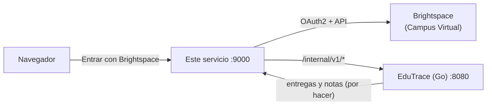
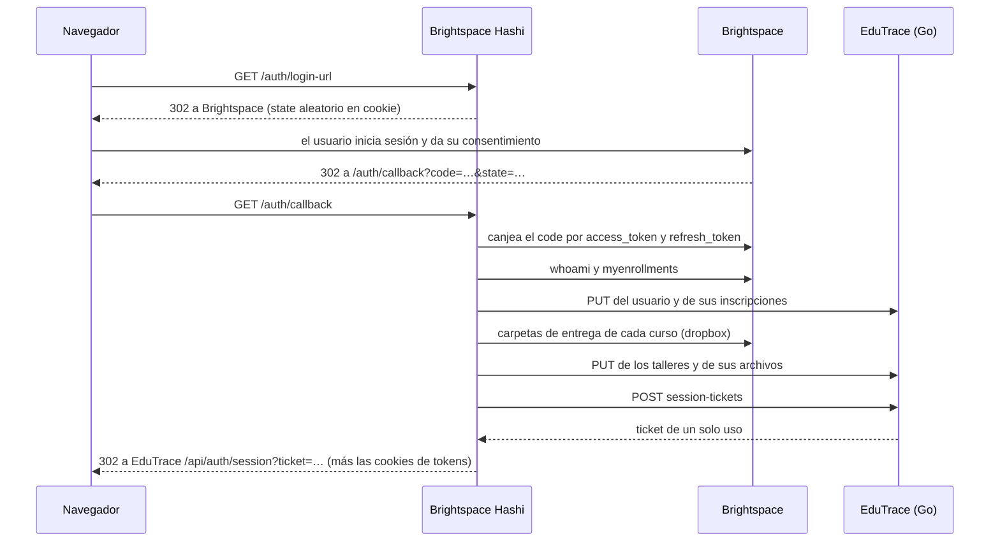

# EduTrace - Brightspace Hashi

**EduTrace - Brightspace Hashi** es el servicio que conecta [EduTrace](https://github.com/alejandrogonzalezo1055/EDU-TRACE) con el **Campus Virtual** de la universidad, que funciona sobre **Brightspace (D2L)**. Es el puente entre las dos plataformas: el estudiante o el docente entra con su cuenta de Brightspace, y las clases, los roles, los talleres y sus archivos llegan solos a EduTrace, sin crear otra cuenta ni copiar nada a mano.

> EduTrace nunca guarda la contraseña de nadie. El usuario se identifica en Brightspace; este servicio solo recibe un permiso (OAuth2) y lo usa para traer lo que EduTrace necesita.

---

## 🧭 Qué hace

- **Inicio de sesión con Brightspace** (OAuth2, flujo de código de autorización): lleva al usuario a Brightspace, recibe el código de vuelta, lo canjea por tokens y abre la sesión en EduTrace.
- **Sincroniza con Go** (el backend de EduTrace): el usuario, sus inscripciones, los talleres de cada curso y los archivos adjuntos de cada taller.
- **Cliente de la API de Brightspace**: consulta quién es el usuario (`whoami`), sus cursos (`myenrollments`), las carpetas de entrega (*dropbox*) y descarga sus adjuntos.
- **Guarda los tokens en cookies HttpOnly**: JavaScript de la página no puede leerlos. No hay base de datos propia.
- **Se protege solo**: limita los intentos de inicio de sesión por IP, valida la versión de la API de Brightspace y exige una clave (`Bearer`) en las rutas internas.

Qué falta: enviar a Brightspace las **entregas** de los estudiantes y las **notas con su retroalimentación** (`dropbox/submit` y `dropbox/feedback`). Ver [Estado y limitaciones](#-estado-y-limitaciones).

---

## 👥 Equipo del proyecto

Grupo #4 · Proyecto de Innovación en TI · Pontificia Universidad Javeriana

| Nombre | Aporte en este repositorio |
| :--- | :--- |
| Alejandro González Ochoa | Autor de este servicio (integración con Brightspace) · https://github.com/alejandrogonzalezo1055 |
| César Santiago Canro Cabra | Equipo EduTrace |
| Iván Santiago Lastra Romero | Equipo EduTrace |
| Marlon Jhoan García Restrepo | Equipo EduTrace |
| Samuel Iregui Franco | Equipo EduTrace |

---

## 🛠️ Tecnologías utilizadas

- **Lenguaje y framework:** Python 3.12 o superior (se desarrolló con 3.14), FastAPI
- **Cliente HTTP:** httpx
- **Configuración y validación:** pydantic, pydantic-settings
- **Servidor:** uvicorn, con HTTPS local de `mkcert`
- **Protocolo:** OAuth2 (Authorization Code) contra Brightspace
- **Control de versiones:** Git

---

## 🔄 Cómo funciona



### El inicio de sesión, paso a paso



1. `GET /auth/login-url` genera un `state` aleatorio, lo guarda en la cookie `oauth_state` (HttpOnly) y redirige a Brightspace. Ese `state` evita ataques CSRF: un callback que este servicio no inició no pasa la comparación.
2. Brightspace devuelve al navegador a `/auth/callback` con un `code` de un solo uso.
3. El servicio canjea el `code` por `access_token` y `refresh_token`, y los deja en cookies (`access_token`, `refresh_token`, `response_time`).
4. Con el `access_token` trae el perfil y las inscripciones del usuario y se los manda a Go; por cada curso trae las carpetas de entrega y sus adjuntos y también se los manda a Go.
5. Pide a Go un **ticket de sesión** y redirige al navegador a `GO_BASE_URL/api/auth/session?ticket=…`. Con ese ticket EduTrace abre la sesión.
6. Si algo falla, el navegador vuelve a `FRONTEND_URL/login?error=…` (por ejemplo `access_denied` o `session_expired`).

El refresh token de Brightspace es de **un solo uso**: cada renovación devuelve uno nuevo y el anterior deja de servir.

---

## 🗂️ Estructura del proyecto

```text
EduTrace - Brightspace Hashi/
├── app/
│   ├── main.py                    # create_app(): routers y middleware
│   ├── middleware.py              # límite de intentos de login y renovación de tokens
│   ├── routers/
│   │   ├── base/
│   │   │   ├── auth_router.py     # /auth/*  (login, callback, tokens)
│   │   │   ├── internal_router.py # /internal/v1/*  (la clave protege estas rutas)
│   │   │   └── health.py          # GET /health
│   │   └── api_v1/
│   │       ├── lp_router.py       # /lp/{versión}/…  Learning Platform de Brightspace
│   │       └── le_router.py       # /le/{versión}/…  Learning Environment de Brightspace
│   └── services/
│       ├── base/
│       │   ├── auth_service.py    # OAuth2 y cookies
│       │   └── internal_service.py# sincronización con Go
│       └── api_v1/
│           ├── lp_service.py      # whoami, myenrollments
│           └── le_service.py      # dropbox: carpetas y adjuntos
├── common/
│   ├── settings.py                # configuración (pydantic-settings)
│   ├── schemas.py                 # modelos, cookies, respuestas y validación de versión
│   ├── errors.py                  # logger
│   └── .env.example               # plantilla (ver «Configuración»)
├── data-brightspace/              # PDF de los talleres que se subieron a Brightspace
├── localhost.pem, localhost-key.pem  # certificado local (mkcert), no se suben
└── README.md
```

---

## 📥 Instrucciones de uso

### 1. Requisitos previos
- **Python 3.12 o superior.** El código usa `match`.
- **mkcert** para el certificado HTTPS de `localhost`. El `redirect_uri` registrado en Brightspace es `https://localhost:9000/auth/callback`, así que el servicio **tiene que** servirse por HTTPS en el puerto 9000.
- Una **aplicación OAuth2 registrada en Brightspace** (ID, secreto y scopes), que la administración del Campus Virtual aprueba.
- **EduTrace (Go)** en marcha, con `INTERNAL_API_KEY` y `PYTHON_API_KEY` definidas. Ver su [README](https://github.com/alejandrogonzalezo1055/EDU-TRACE).

### 2. Instalar

```bash
python3 -m venv .venv
source .venv/bin/activate
pip install fastapi httpx pydantic-settings uvicorn
```

No hay `requirements.txt` ni `pyproject.toml`. Las dependencias salen de los imports del código.

### 3. Certificado local

```bash
mkcert -install
mkcert localhost 127.0.0.1 ::1
```

Deja `localhost.pem` y `localhost-key.pem` en la raíz del proyecto. Para que Go confíe en el certificado, su `PYTHON_CA_FILE` apunta a `$(mkcert -CAROOT)/rootCA.pem`.

### 4. Configuración

Las variables se leen de `common/.env` (ruta relativa: **ejecuta el servicio desde la raíz del proyecto**). `common/.env` no se sube a git. **Nunca pongas el secreto de la aplicación en un documento ni lo subas.**

| Variable | Para qué sirve |
|---|---|
| `API_BASE_URL` | Host de Brightspace para la API y el logout (sin `https://`) |
| `AUTH_BASE_URL` | Host de Brightspace para autorizar y emitir tokens (sin `https://`) |
| `APP_ID`, `APP_SECRET` | Credenciales (`client_id` y `client_secret`) de la aplicación registrada en Brightspace |
| `APP_SCOPE` | Scopes pedidos, separados por **espacios** |
| `INTERNAL_API_KEY` | Clave con la que este servicio llama a Go (≥32 bytes). Misma que la de Go |
| `PYTHON_API_KEY` | Clave que Go manda a este servicio como `Authorization: Bearer` (≥32 bytes). Misma que la de Go. Distinta de `INTERNAL_API_KEY` |
| `GO_BASE_URL` | URL de EduTrace (Go), por ejemplo `https://localhost:8080` |
| `FRONTEND_URL` | URL del frontend, a donde vuelve el navegador si el login falla |
| `CA_FILE` | `rootCA.pem` de mkcert (el archivo, no la carpeta), para confiar en el HTTPS de Go |
| `LP_VERSION`, `LE_VERSION` | Versión de la API de Brightspace (Learning Platform y Learning Environment) |

> ⚠ `common/.env.example` quedó con las variables de una versión anterior (`MOCK_*`). Usa la tabla de arriba como referencia hasta que se actualice la plantilla.

Scopes con los que se desarrolló (los habilitó la administración del Campus Virtual): `users:own_profile:read`, `enrollment:own_enrollment:read`, `enrollment:orgunit:read`, `grades:gradeobjects:read`, `grades:gradevalues:read`, `dropbox:folders:read`, `content:completions:read`, `content:file:read`, `content:modules:readonly`, `content:toc:read` y `content:topics:readonly`. Un scope mal escrito o no habilitado da `invalid_scope` sin decir cuál falló: se prueban de uno en uno.

### 5. Ejecutar

```bash
uvicorn app.main:create_app --factory --port 9000 \
  --ssl-keyfile localhost-key.pem --ssl-certfile localhost.pem
```

- `--factory` es obligatorio: `create_app()` es una función que crea la app.
- Sin `--reload`, los cambios de código no se recogen.
- Usa **`localhost`, no `127.0.0.1`**: las cookies son por host y el `redirect_uri` registrado usa `localhost`.
- Tras cambiar `common/.env` hay que reiniciar y volver a iniciar sesión (un token ya emitido conserva sus scopes).

### 6. Probar

1. Con Go y este servicio en marcha, abre el frontend de EduTrace y pulsa **Entrar con Brightspace**.
2. Para ver los logs: la consola de `uvicorn`. Verás si Go aceptó cada curso y cada taller.
3. Comprobación rápida de vida: `curl --cacert "$(mkcert -CAROOT)/rootCA.pem" https://localhost:9000/health`.
4. Para cerrar sesión en Brightspace y cambiar de usuario: `https://localhost:9000/auth/logout-url`.

---

## 🔌 Rutas

| Método | Ruta | Qué hace |
|---|---|---|
| GET | `/health` | Sondeo de vida |
| GET | `/auth/login-url` | 302 a Brightspace con `state` aleatorio |
| GET | `/auth/callback` | Recibe `code` y `state`, canjea los tokens, sincroniza con Go y redirige con el ticket |
| GET | `/auth/logout-url` | 302 al cierre de sesión de Brightspace (borra las cookies de este servicio) |
| POST | `/auth/obtain-token` | Renueva el access token (`refresh`) o lo obtiene (`access`) |
| GET | `/lp/{versión}/users/whoami` | Quién es el usuario en Brightspace |
| GET | `/lp/{versión}/enrollments/myenrollments/` | Cursos y roles del usuario (todas las páginas) |
| GET | `/le/{versión}/{orgUnitId}/dropbox/folders/` | Carpetas de entrega de un curso (los talleres) |
| GET | `/le/{versión}/{orgUnitId}/dropbox/folders/{folderId}/attachments/{fileId}` | Descarga un adjunto de un taller |
| GET, PUT, POST | `/internal/v1/*` | Rutas internas, protegidas con `Authorization: Bearer <PYTHON_API_KEY>` |

El servicio valida la versión de la API contra las que Brightspace soporta: si la versión de la ruta no es válida responde 406.

---

## ⚠️ Estado y limitaciones

**Funciona** (verificado contra el Brightspace de pruebas):
- Inicio de sesión con Brightspace, canje y renovación de tokens.
- Sincronización de usuario, inscripciones, talleres y archivos adjuntos con Go.

**Falta:**
- `dropbox/submit`: enviar a Brightspace las entregas oficiales de los estudiantes.
- `dropbox/feedback`: devolver a Brightspace la nota y la retroalimentación que aprueba el docente.
- Mientras tanto, la cola de Go hacia Brightspace está pausada (`D2L_QUEUE_PAUSED` en Go): las entregas y revisiones quedan	 guardadas en EduTrace y no se envían.

**Limitaciones conocidas:**
- **Renovación automática de tokens (middleware):** mira los `Set-Cookie` de la *respuesta* y no las cookies de la *petición*, por eso casi nunca se activa. Mientras tanto la renovación es manual con `POST /auth/obtain-token`.
- **Bloqueo por demasiados intentos de login:** máximo 8 intentos por IP en una ventana de 5 minutos; al pasarse, 10 minutos de bloqueo. El contador vive en memoria: se pierde al reiniciar.
- **Errores de Go o Brightspace** a mitad del callback se devuelven al navegador como respuesta cruda en algunos casos, y no siempre como redirección a `/login?error=…`.
- **Sincronización por usuario:** si dos usuarios del mismo curso ven carpetas distintas, el último en entrar define cuáles quedan visibles (inferencia por el comportamiento de Go, sin probar).
- **Rutas internas duplicadas:** `internal_router.py` aún declara rutas (`PUT /users…`, `…/enrollments`, `…/assignments`, `POST /session-tickets`) que le corresponden a Go según el contrato.
- **Sin pruebas automáticas** ni `requirements.txt`.
- El `redirect_uri` (`https://localhost:9000/auth/callback`) está fijo en el código: cambiar de host o puerto exige editar `auth_service.py`.

---

## 🎓 Contexto académico

Proyecto de Innovación en TI, Pontificia Universidad Javeriana (Grupo #4). EduTrace es una plataforma de retroalimentación formativa para Introducción a la Programación, donde la IA propone y el profesor decide. Este servicio es la parte que la conecta con el Campus Virtual.

---

## 📧 Contacto

**Alejandro González Ochoa**
Estudiante de Ingeniería de Sistemas, Pontificia Universidad Javeriana
GitHub: https://github.com/alejandrogonzalezo1055

---

## ⚖️ Licencia

Proyecto desarrollado con fines académicos.
